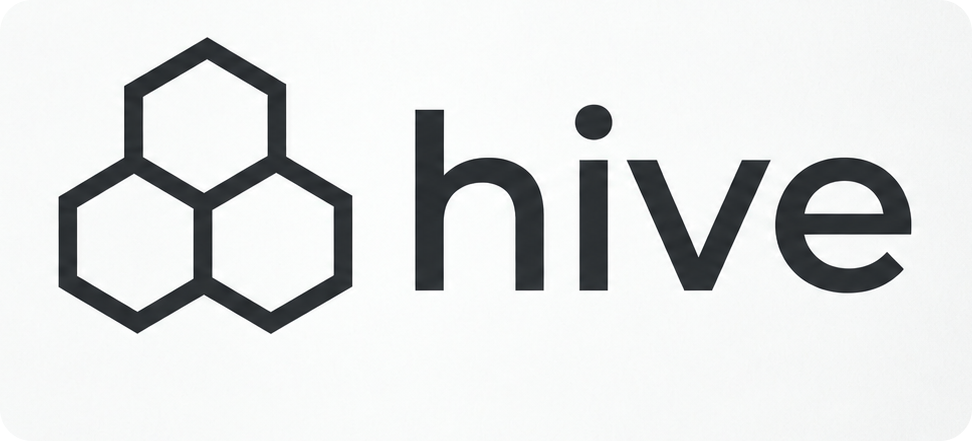

<div align="center">
  
</div>

<h1 align="center">Hive</h1>

Hive runs Codex and Claude agents as persistent, separately addressable
conversations. A local daemon owns provider processes, schedules work, stores
messages and results, and resumes conversations when more input arrives. Agents
can delegate work, exchange reviews, ask a human questions, and branch an existing
conversation into a new agent.

An **agent ID** survives unloading and orderly daemon restarts. Use
`hivectl daemon restart` to stop the daemon, confirm cleanup, and start the selected
build with its configuration. A **turn** is one
provider interaction consuming one message. Ending a turn leaves the task open;
explicit completion ends the task. An idle agent does not need to keep a provider
process loaded. All agents currently have flat visibility: parent relationships
record delegation and lifetime, not permissions.

The [CLI reference](docs/cli-reference.md) documents every command, option,
configuration setting and example. The bundled [agent skill](skills/hive/SKILL.md)
explains how an AI agent should operate Hive and links to the CLI reference for
commands.

## Contents

- [Quick start](#quick-start)
- [Agents in your terminal](docs/terminal.md)
- [Check configuration](#check-configuration)
- [API-key profiles](#api-key-profiles)
- [CLI reference](docs/cli-reference.md)
- [Agent tools and bundled skill](#agent-tools-and-bundled-skill)
- [Shared Comb](comb/README.md)
- [Recovery and operating limits](#recovery-and-operating-limits)
- [Security model](#security-model)

For source installation and supported systems, see [installation](docs/platforms-and-installation.md).
For an incompatible state directory, follow [fresh-state setup](docs/platforms-and-installation.md#incompatible-state).
Current builds have pre-release status; see the [compatibility policy](docs/compatibility.md).

| Part | Install choice | Included capability |
| --- | --- | --- |
| Hive (default) | Installer default | Agent orchestration and hosted Comb tools when configured |
| Hive core | `--core` | Agent orchestration without Comb integration |
| Comb | `--comb` | Standalone knowledge server, text search and HTTP embeddings |

Install the current preview (macOS Apple Silicon and Linux arm64):

```sh
HIVE_RELEASE=https://github.com/metacircu1ar/hive/releases/download/v0.1.0-preview.1
curl -fsSLO "$HIVE_RELEASE/install.sh"
sh install.sh --from "$HIVE_RELEASE" --prefix "$HOME/.local" --comb
# Core Hive plus standalone Comb:
sh install.sh --from "$HIVE_RELEASE" --prefix "$HOME/.local" --core --comb
```

`--from` also accepts a local directory holding a downloaded release.

Current native builds for macOS Apple Silicon and Linux arm64/x86_64 are also
[included in this repository](https://github.com/metacircu1ar/hive/tree/main/binaries),
with checksums, build records and license notices. From a macOS Apple Silicon clone:

```sh
HIVE_BINARIES="$PWD/binaries/aarch64-apple-darwin"
export PATH="$HIVE_BINARIES/hive/release:$HIVE_BINARIES/comb/release:$PATH"
hivectl --version
comb --version
```

On Linux, use `aarch64-unknown-linux-gnu` or `x86_64-unknown-linux-gnu` instead.
Use `hive-core/release` in place of `hive/release` for core Hive.

Default installation includes `hivectl` and `hive-daemon`; adding Comb is optional. Core
Hive cannot host Comb tools even if standalone `comb` is installed. See the
platform guide for supported systems. The installer verifies the
selected archives, refuses unrelated command-name collisions, and switches the
CLI/daemon pair atomically. It keeps unselected parts, state and logins. See
[installation and upgrade behavior](docs/platforms-and-installation.md).

The default build includes Comb integration. Core has no Comb
hosted tools, evidence command or collector delivery. It rejects any `comb` or
`comb_collectors` configuration key, including role bindings. `hivectl --version`
and `hivectl status` identify the compiled capabilities.

Both builds use the same current state layout. When switching to core, remove
Comb keys from the configuration first. Saved Comb-bound agents and collector
queues remain intact: status shows `held_for_build: "comb"` and retained backlog
counts, and unrelated agents can run. Resume and branching require restoring the
capable build. Async sends retain their message IDs; calls and waits return `held`
promptly. Restoring the capable build lets retained work continue. A new joined
batch targeting a held agent is rejected atomically.

## Quick start

Install the current preview with `curl` and follow the setup wizard:

```sh
HIVE_RELEASE=https://github.com/metacircu1ar/hive/releases/download/v0.1.0-preview.1
curl -fsSLO "$HIVE_RELEASE/install.sh"
sh install.sh --from "$HIVE_RELEASE" --comb
export PATH="$HOME/.local/bin:$PATH"
hivectl doctor
hivectl spawn --cwd . --body 'Describe this repository. Do not change files.'
```

On macOS, download with `curl` as shown: release programs are not notarized,
and a browser download is quarantined. See
[macOS downloads](docs/platforms-and-installation.md#macos-downloads-and-gatekeeper).

Setup saves provider defaults, configures optional Comb and starts user login
services. It keeps its own isolated Codex/Claude logins. The
[setup guide](docs/setup.md) covers source builds, every setup flag, scripted
answers, native/HTTP models, services, upgrades, removal and manual setup.

Use the returned `agent_id` to inspect the agent:

```sh
hivectl status AGENT_ID
hivectl read AGENT_ID
hivectl read AGENT_ID --follow # Durable activity as it is recorded.
hivectl live AGENT_ID --follow # Streamed text and tool output as it happens.
hivectl attach AGENT_ID        # A chat view: history, live output and input.
hivectl panes                  # Inside zellij or tmux: one pane per live agent.
hivectl tui                    # Every agent in one terminal: tree, tabs, questions.
hivectl wait AGENT_ID --until completed --timeout 60
```

[Agents in your terminal](docs/terminal.md) covers `hivectl tui`, `hivectl attach` and
`hivectl panes`: every key, command and option, and which terminals each supports.

Use `hivectl logs --level warn --follow` to watch daemon diagnostics, or
`hivectl logs --agent AGENT_ID --tail 100` to inspect one agent's recent records.
This human viewer also works while the daemon is stopped. See the
[CLI reference](docs/cli-reference.md#daemon) for filters, retention and privacy.

## Agent settings

Discover supported options, then change an agent's future turns:

```sh
hivectl options catalog --provider codex
hivectl set-options AGENT_ID --option model=gpt-6-luna --option effort=low \
  --request-id settings-1
hivectl status AGENT_ID
```

Options persist and take effect at the next turn boundary. A null value restores
the frozen spawn setting. Spawn also accepts `--preset`, typed `--option` values
and a snapshotted `--native-config` file. See the [option reference](docs/cli-reference.md#change-agent-options-or-login)
for every key, inheritance, native-config privacy and process limits.

Give an agent a name for people with `spawn --name` or
`hivectl set-name AGENT_ID reviewer`. Names are labels, not IDs, and need not be
unique; views and listings show them. See [agent names](docs/cli-reference.md#agent-names).

## Check configuration

Check a configuration without starting agents or contacting providers:

```sh
hivectl --config examples/auth.yaml config check
hivectl --config examples/auth.yaml config check --fix
```

The optional fix applies registered safe key renames with a private backup; it
does not restart the daemon. There are currently no deprecated keys, so a valid
configuration remains unchanged. See the
[configuration reference](docs/cli-reference.md#configuration-and-capacity) and
[compatibility policy](docs/compatibility.md#public-interfaces-and-deprecation).

## Spread agents across logins

With several subscriptions for one provider, a balanced group spreads new agents
across them by weight instead of filling one account until it hits its limit:

```yaml
auth_groups:
  codex-pool:
    mode: balanced
    members: [codex-main, {profile: codex-team, weight: 3}]
```

`spawn --auth codex-pool` gives each agent the least loaded usable login. Agents
stay on their login while it is usable. When it is limited, agents with pending
work move to the other members at their next turn boundary, and idle agents keep
their conversation. `hivectl auth groups` shows each member's load, and agent `status`
shows why its login was chosen. An `ordered` group uses its members as a fallback
chain instead. See [login groups](docs/cli-reference.md#login-groups).

## API-key profiles

Hive supports both subscriptions and paid API keys for Codex and Claude. Configure
an API profile with exactly one source: an environment-variable name (`api_key_env`)
or a private key file (`api_key_file`). Never put the key itself in YAML, command
arguments or agent messages. API inference is billed by the provider; set spending
limits there.

With `OPENAI_API_KEY` already supplied privately to the process, save `api.yaml`:

```yaml
auth_profiles:
  codex-api:
    provider: codex
    method: api_key
    api_key_env: OPENAI_API_KEY
```

```sh
hivectl --config api.yaml auth login codex-api
hivectl --config api.yaml daemon start
hivectl --config api.yaml auth status codex-api
hivectl --config api.yaml models --auth codex-api
# Replace MODEL and EFFORT with a pair returned above:
hivectl --config api.yaml spawn --auth codex-api --model MODEL --effort EFFORT \
  --cwd . --body 'Describe this repository.'
```

API `login` registers an isolated profile without an interactive challenge or
inference turn. `present_unverified` means the source is readable, not that the
provider has accepted the key. Status uses the running daemon's environment and
labels the observation. Changing a terminal variable does not change a daemon;
restart it to rotate an environment key. A private file can be replaced while
the daemon runs; new provider acquisitions use the new key, while already loaded
conversations may keep their original process until unload/relaunch. Rotation
keeps the same native conversation.

See [API authentication](docs/cli-reference.md#api-key-profiles) for file permissions,
service environments, failures and recovery, and
[login groups](docs/cli-reference.md#login-groups) for explicit
subscription-to-API fallback and its opt-out.

## Attach files and images

Pass screenshots, logs, or other files with repeatable `--attach` flags:

```sh
hivectl send AGENT_ID --body-file question.md \
  --attach screenshot.png --attach trace.log --request-id inspect-files-1
```

Files are captured when the message is accepted, so queued and scheduled input
keeps the original bytes. Larger files remain clearly labeled live paths.
Eligible images go directly into Codex or Claude turns; all files also get a
reference for file tools. See [files and images](docs/cli-reference.md#files-and-images)
for limits, agent tools, steering, retention, and replay rules.

Spawn working directories may be absolute or relative to your current directory.
They must exist and have a UTF-8 absolute path.

For short messages, use `hivectl send AGENT_ID --body "Review the latest diff."`.
Task completion also accepts inline text: `hivectl complete AGENT_ID --body "Done."`.
Lifecycle commands (`stop`, `resume`, `interrupt`, `complete`, `terminate`) accept
`--request-id` for retrying the same accepted request without applying it again.
See the [CLI reference](docs/cli-reference.md#stop-resume-interrupt-complete-terminate)
for retry and asynchronous completion semantics.

## Collect several replies together

A joined batch collects each worker's turn output into one result. Save this as
`reviews.json`, replacing the reviewer IDs with existing agents:

```json
[
  {"op":"send","target":"REVIEWER_A","body":"Review correctness. Return findings as your final answer; stay available for another round.","request_id":"review-a-1"},
  {"op":"send","target":"REVIEWER_B","body":"Review error handling. Return findings as your final answer; stay available for another round.","request_id":"review-b-1"}
]
```

Submit it, then use the returned `join.join_id` in the wait/read commands:

```sh
hivectl batch --operations-file reviews.json --request-id review-round-1 --join
hivectl wait --join JOIN_ID --timeout 45
hivectl read join:JOIN_ID
```

A hosted agent uses `hive_batch` with `join: {}`, then ends its turn. The
combined answer wakes its existing conversation. An optional deadline delivers a
partial result and continues collecting. See the [complete join example and
semantics](docs/cli-reference.md#collect-replies-with-a-join), including timeout,
output limits and cleanup.

## Agent tools and bundled skill

The distributable agent guide is [skills/hive/SKILL.md](skills/hive/SKILL.md).
Hosted agents can use `@parent` or `@child` in `hive_send` and `hive_terminate`,
including batch items, without copying UUIDs. `@child` requires exactly one retained
direct child, counting ended children too; ambiguous targets fail with guidance
to list children. Human CLI commands and other tools use exact agent IDs.
Load it into an agent that will use Hive. It explains the coordination workflow
and links to the [CLI reference](docs/cli-reference.md) for commands. Keep
`docs/cli-reference.md` and `skills/hive/SKILL.md` in their repository-relative
layout when distributing them, or give the agent an explicit path to the matching
CLI reference. Copying the skill alone loses its command reference. Merely placing
this file in the repository does not install it into an outside agent's skill
registry.

An agent **hosted by Hive** receives identity-bound `hive_*` tools
automatically. The [hosted tool reference](docs/cli-reference.md#hosted-agent-tools)
lists all 12 with example arguments.

Use these tools for delegation and questions instead of native provider subagents
or interactive question tools. Hive supplies the coordination instructions and
provider tool guards. End the current turn when waiting for messages; later input
resumes the saved conversation. Reuse an existing reviewer ID for successive rounds
so it keeps its context. For ordinary delegation, explicitly send findings to the
requesting agent. For a joined batch, return findings as the member turn's final
answer so Hive can collect them together.
Use `hive_complete` only when the task and required review are finished.

## Recovery and operating limits

The daemon separates saved agents from loaded conversations and provider processes.
Orderly unloading/restarting preserves native conversation identity. After a crash,
input whose delivery cannot be proved becomes uncertain and is not replayed.
Provider cleanup uses recorded process identity, writer locks, and credential
ownership; if it cannot prove safety, status exposes a fence for the affected work.
Use the [auth recovery commands](docs/cli-reference.md#recover-repair-prune-and-export) rather than deleting
locks, moving tokens, or killing a process by a stale PID.

An interrupted shell task is checked through the provider's cleanup machinery,
with bounded observation of late activity. This is not a guarantee against every
detached or untracked descendant. Inspect shutdown/recovery status before reusing
an affected session or purging it.

Every accepted message and reply waits for a durable write. Under sustained
write load, some storage devices stall their cache flushes for hundreds of
milliseconds at a time, and replies pause with them: on a Mac SSD, throughput fell
by up to a fifth while the stalls lasted. Hive does not weaken durability to hide
these pauses.

At tight residency limits, frequent provider restarts also make sustained
throughput depend on durable launch and retirement receipts. If new work arrives
faster than storage can support, the pending queue grows even while submissions
remain responsive. Reduce the arrival rate, or increase residency when memory
and provider limits allow, to reduce process turnover. Hive does not guarantee a
fixed agent-start rate across storage devices.

See [provider compatibility](docs/compatibility.md) for version admission and
provider-specific capability limits.

Current scope: Codex and Claude subscription/API-key agents, flat visibility, parent-bound
lifetimes, durable asynchronous messages, joined batches, external calls, approvals, Codex branching,
Claude branching with copied-history checks, manual and grouped login changes. Graphs, graph permissions,
and cross-login native history cloning are not implemented. Do not infer an
execution permission boundary from a parent link or an advisory approval.

If Hive reports an incompatible state directory, use a new `--state-dir`; see
[fresh-state setup](docs/platforms-and-installation.md#incompatible-state).
Keep private state and credentials out of source control.

## Security model

Hive gives the same guarantees as running that many Claude Code or Codex
instances yourself. It adds no isolation between agents.

- Each agent is confined only by its provider's sandbox and tool policy: the
  `workspace-write` or `read-only` sandbox chosen at spawn, and the provider's
  own tool checks.
- `full-access` disables the native filesystem and network sandbox. The agent
  acts as your user: it can read every login's credentials, modify Hive state,
  stop the daemon or other agents, install software, and commit or push code.
  Hive cannot protect its own files from such an agent. Claude's native subagent
  and cron tools remain disabled so coordination goes through Hive.
- By default, requests through a hosted agent's Hive tools cannot choose a
  wider sandbox than their caller:
  `read-only` < `workspace-write` < `full-access`. The check includes role
  defaults, branches and batch operations. Human CLI/TUI spawns can choose any
  mode. This is a spawn policy, not an additional OS or user-identity boundary.
  Set `runtime.allow_spawn_widening: true` to permit wider child modes through
  those tools. Branches still keep their source's mode.
  Control-socket clients are trusted as the human user; the socket does not
  infer an agent identity from the connecting process. A live check with Codex
  0.163.0 in `workspace-write` on macOS was denied by the native sandbox before
  connecting (`EPERM`). Linux socket access remains unverified; do not rely on
  this macOS result as a cross-platform restriction.
- Visibility is flat. Any hosted agent can message, rename, reconfigure,
  terminate or spawn any agent through its `hive_*` tools. Parent links record
  delegation and lifetime, not permissions.
- Questions and approvals (`hive_ask`) are questions to a human, not a
  permission boundary.
- Agents on one login share that provider account and its limits.
- The state directory, its credentials and the control socket are private to
  your user account. Anyone who can act as that user controls every agent.

Restricting which agents may contact each other (isolated graphs) is not
implemented.

For work that needs unrestricted filesystem, network or Git access:

```sh
hivectl spawn --sandbox full-access --cwd /absolute/path/to/repo \
  --body "Implement the change and commit it locally."
```

New roles still default to `workspace-write`. Roles can explicitly set
`sandbox: full-access`; `hivectl doctor` warns about those role defaults and
`runtime.allow_spawn_widening: true`. Status, agent
listings and tree replies include the sandbox, and terminal views mark
`full-access` in red. A branch always keeps its source's sandbox.

## Shared Comb

The optional [Comb service](comb/README.md) gives agents shared project knowledge:
searchable summaries, append-only evidence, explicit review, and text or semantic
retrieval. One `comb serve` process owns an Comb; hosted tools share it without
loading a model or database per agent. Configure a private bridge credential under
`comb` globally or per role. Additional stdio MCP servers are supported separately
under `mcp_servers`; see the [configuration reference](docs/cli-reference.md).

Fresh setup uses text search. Semantic search uses any OpenAI-compatible HTTP
embedding endpoint; existing selections are preserved. A local GPU option is
**Qwen3-Embedding-8B Q8_0 on Metal**, served by llama.cpp. The
[embedding guide](comb/README.md#embeddings) covers this route.

Opt-in `comb_collectors` retain public review/correction evidence and allowlisted
lifecycle outcomes for later curation. Use `hivectl evidence`, inspect delivery
with `hivectl collectors status`, and run the ordinary
[curator role and skill](skills/comb-curator/SKILL.md) on demand. The complete
[learning command reference](docs/cli-reference.md#shared-learning-evidence) covers
retries, key changes, backlog limits and cleanup; the [Comb reference](comb/README.md)
covers consolidation and explicit proposal decisions.
